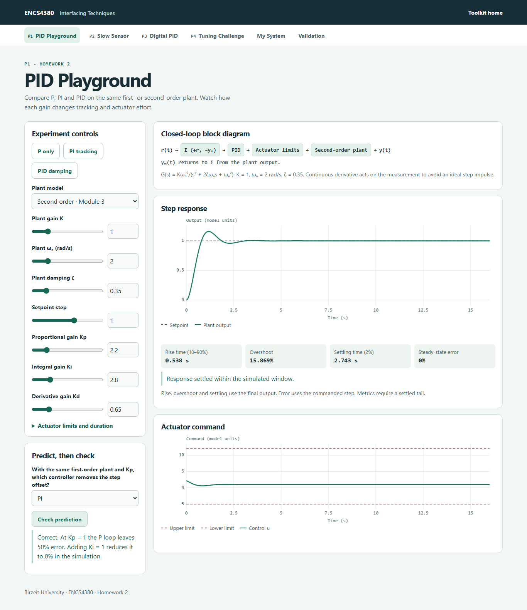

# ENCS4380 Dynamic Characteristics Toolkit

Birzeit University · ENCS4380 Interfacing Techniques · Dr. Wasel Ghanem

Explore sensor dynamics in Homework 1 and closed-loop PID control in Homework 2. The toolkit is static HTML, CSS and JavaScript. The Homework 2 charts and simulations run directly in the browser. The original Homework 1 plots load Plotly.js or Chart.js from a CDN.

[GitHub repository](https://github.com/BasilZreaq/homework1) · [Homework 2 release](https://github.com/BasilZreaq/homework1/releases/tag/v2.0)

The [GitHub Pages address](https://basilzreaq.github.io/homework1/) requires the repository administrator to enable Pages from `main` and `/(root)`.

## Homework 1 · Sensor dynamics

| Module | What to explore | Owner recorded in Homework 1 |
| --- | --- | --- |
| [1 · First-Order Time Response](module1.html) | Step and ramp inputs, time constant, lag and error | Basil (`@BasilZreaq`) |
| [2 · First-Order Frequency Response](ahmad_index.html) | Sine amplitude and phase, Bode plots and dynamic error | Ahmad (`@ahmadd923`) |
| [3 · Second-Order Response](Module3-Majd.html) | Damping, poles, phase plane and mass-spring-damper state space | Majd (`@majdds`) |
| [4 · Guess the Sensor](Module4_GuessTheSensor_Zaid.html) | Estimating a hidden model from noisy measurements | Zaid (`@zaidrasras31`) |

## Homework 2 · Control

| Module | What to explore | Tracking issue |
| --- | --- | --- |
| P1 · PID Playground | First- and second-order plants, P/PI/PID presets, step metrics and actuator limits | [#1](https://github.com/BasilZreaq/homework1/issues/1) |
| P2 · Slow Sensor in the Loop | Actual and measured outputs, increased overshoot and continuing oscillation | [#2](https://github.com/BasilZreaq/homework1/issues/2) |
| P3 · Digital PID | Sample periods, zero-order hold, anti-windup and Arduino code | [#3](https://github.com/BasilZreaq/homework1/issues/3) |
| P4 · PID Tuning Challenge | Tune a hidden plant for ≤10% overshoot, ≤5 s settling and ≤1% absolute step error | [#4](https://github.com/BasilZreaq/homework1/issues/4) |
| My System | First-order plant evidence, project targets, controller simulation and Arduino code | |
| Numerical Validation | Eight calculated checks covering all three assignment cases | |

The repository identifies Homework 1 ownership. P1–P4 ownership awaits confirmation from the team.

## Run locally

From the repository root, start a static file server with Python 3, then open [the toolkit](http://localhost:8000/).

```sh
python -m http.server 8000 --bind 127.0.0.1
```

## Simulation and validation

- **Plants.** The first-order equation is τẏ = Ku − y. The second-order model uses ẏ = v and v̇ = ωₙ²(Ku − y) − 2ζωₙv. Both reuse the Homework 1 transfer functions.
- **Feedback.** The controller uses e = r − yₘ. P2 integrates τₛẏₘ = y − yₘ. At τₛ = 0 the measurement equals the plant output.
- **Continuous PID.** P and I act on tracking error. The derivative acts on yₘ to avoid an impulse at the setpoint step. The continuous controller updates within each RK4 step.
- **Digital PID.** At each sample, add Ki·Tₛ·e[k] to the integral term and use Kd·(e[k] − e[k−1])/Tₛ, with e[−1] = 0. Apply limits and hold the resulting command until the next sample. Conditional integration skips increments that would drive saturation further and allows increments that unwind it.
- **Metrics.** Rise time spans the interpolated 10% and 90% crossings of the equilibrium excursion. Overshoot and 2% settling refer to the reachable equilibrium. Step error is setpoint minus the mean of the final part of the output, reported relative to the magnitude of the step. The validator requires a final window within 0.5% of the reachable equilibrium. Metrics are withheld when convergence is insufficient or the integration diverges.

The validation page reports expected values, calculated values and absolute tolerances. Proportional control gives τ ≈ 0.10008 s (tolerance 0.001 s) and 10% step error (tolerance 0.05 percentage points). The PI characteristic equation gives ωₙ = 1 rad/s and ζ = 1 (tolerance 10⁻⁶ each). The simulated reference PI step matches 1 − e⁻ᵗ within 10⁻⁶, and three stable unsaturated PI cases have terminal errors below 10⁻⁴ model units.

### Automated tests

Node.js 22+ runs the numerical tests. A C++ compiler such as GCC enables the second command. The Arduino test compiles the sketch logic against stub I/O and checks numerical parity, timing, rollover and invalid-measurement handling.

```sh
node --test tests/engine.test.mjs
node --test tests/arduino.test.mjs
```

For browser tests, install Playwright in the ignored tools directory. With PowerShell, the following commands run the site at a GitHub Pages-style subpath, check desktop and mobile interactions, and exercise the existing Homework 1 plots.

```powershell
npm install --prefix .test-tools --no-save playwright
$env:PLAYWRIGHT_MODULE = "$PWD/.test-tools/node_modules/playwright"
& "$PWD/.test-tools/node_modules/.bin/playwright.cmd" install chromium
node --test tests/browser.test.mjs
```

Set `BROWSER_PATH` to an existing Chromium or Edge executable to use it with Playwright. The legacy plotting regression tests require internet access for the CDN scripts.

## My System · Project evidence

The available project files do not establish the group's project identity, measured gain K, time constant τ, units, or hardware interface. My System starts with labeled illustrative inputs. Enter the plant and source (a step-test record or a cited datasheet), the required response, why it matters, and the controller gains. Save the record in the browser to load it from P1–P3. The record stays in that browser. For a shared submission, add the reviewed record to `publishedProject` in [control/lab.mjs](control/lab.mjs).

If the project is a Micromouse, select the drive-motor option to fix the actuator range at 0–100% PWM. The model displays the continuous PI reference damping ratio for comparison against 0.6–0.8. Evaluate the sampled response separately. The generated code includes functions for calibrated I/O and the project's stop action.

## Screenshots



Homework 1 Module 1 screenshots are available for the [step response](image.png) and [ramp response](image-1.png).

## AI usage

Homework 1 used AI assistance for the initial Module 1 development, HTML/CSS and organization of the JavaScript, as recorded in the original README. For Homework 2, Codex assisted with software implementation, architecture, debugging, tests, integration, code documentation, Git and release operations. The group is responsible for explaining the course theory, selecting its project parameters and requirements, interpreting the results, and providing any experimental evidence.

## References

- ENCS4380 Homework 1 and Homework 2 requirements, Dr. Wasel Ghanem
- [Plotly.js](https://plotly.com/javascript/)
- [Chart.js](https://www.chartjs.org/docs/)
