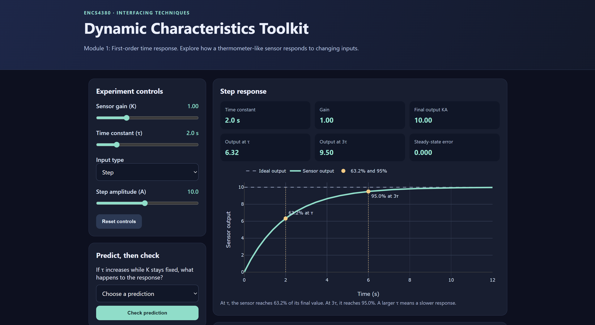
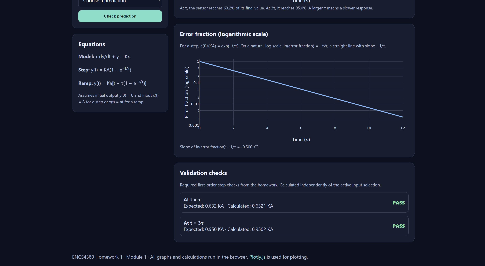

# ENCS4380 Dynamic Characteristics Toolkit

Homework 1, Interfacing Techniques  

## Project Overview

An interactive web toolkit for visualizing the dynamic behavior of first-order and second-order sensors.

## Live Website

https://github.com/majdds/ENCS4380-Micromouse'

## Modules

1. **First-Order Time Response:** Step and ramp responses, time constant, and error analysis.
2. **First-Order Frequency Response:** Sine waves, phase lag, and Bode plots.
3. **Second-Order Response:** Damping, overshoot, settling time, and state-space representation.
4. **Guess the Sensor:** Interactive challenge to estimate sensor parameters.

## Technologies

- HTML, CSS, JavaScript
- Plotly.js
- GitHub Pages

## Team Contributions

| Member | Responsibility |
|---|---|
| Basil | Module 1: First-order time response |
| Zaid | Module 2: First-order frequency response |
| Majd | Module 3: Second-order response and state space |
| Ahmad | Module 4: Guess the Sensor |

## Screenshots

![Module 1 Screenshot]! 

![Module 1 Screenshot 2]! 
## AI Usage

AI tools were used to assist with the initial development of Module 1, write the HTML and CSS and assist with organizing and simplifying the JavaScript functions.

## References

- ENCS4380 Homework 1, Dr. Wasel Ghanem
- [Plotly.js](https://plotly.com/javascript/)
- [GitHub Pages](https://pages.github.com/)